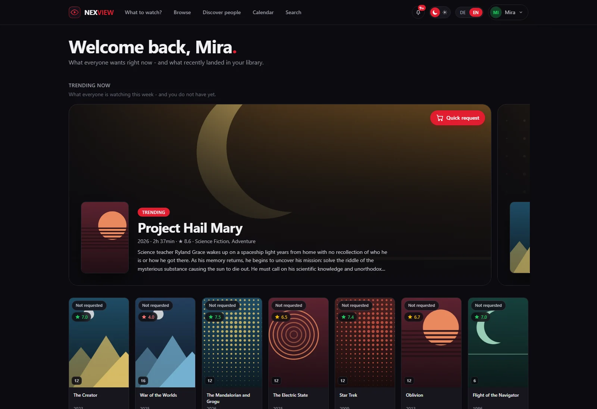
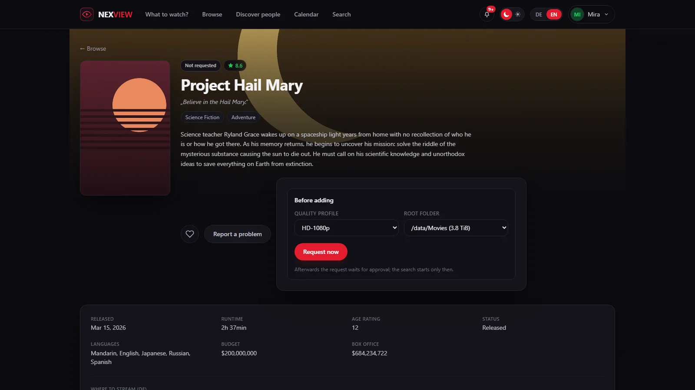
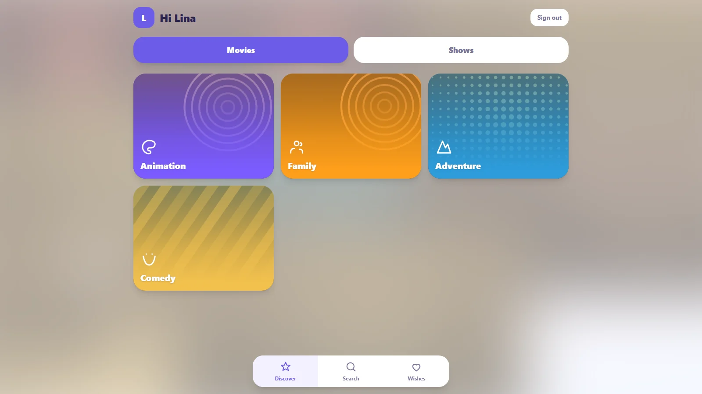

<div align="center">


# Nexview

**Find something to watch — and request it straight from Radarr and Sonarr, or from nexcrate.**

[Changelog](CHANGELOG.md) · [Report an issue](https://github.com/DerKezorm/nexview/issues/new)

</div>

Nexview is a self-hosted media discovery dashboard for a household — family, flatmates,
a circle of friends. It shows new releases from [TMDB](https://www.themoviedb.org/),
marks what is already in your library, and hands requests to whatever procures for you:
**Radarr** (movies) and **Sonarr** (shows), or **nexcrate**, which does both in one.
Everyone gets their own account, with roles, approvals and quotas.

You pick one of the two when you set Nexview up, and you can switch later — an assistant
walks through it and writes a backup first, because there is no other way back.

It downloads nothing itself and stores no media. It is the front door to a setup you
already run — it does not replace any part of it.

Without a TMDB key Nexview starts with sample data, so you can look around before
deciding anything.

---

<div align="center">



<sub>The home page. What each person marks as a favourite shapes what they get suggested.</sub>

<br><br>




<sub>Requesting a title, and the same installation seen by a child.</sub>

</div>

---

## What it does

**Finding something**

- Separate areas for movies and shows, each with its own logic
- Filter by period, language, region, genre, rating and studio; cards or list
- Detail pages with cast photos, directing and writing credits, studios, keywords,
  similar titles and the trailer in a window
- Ratings from IMDb, Rotten Tomatoes and Metacritic on the title itself
- Where a title is currently streaming in your region, split into subscription, free,
  rent and buy (data from JustWatch)
- Browse people — actors, directors, writers — and mark them as favourites; your
  favourites, titles and people alike, shape what gets suggested on your home page
- A release calendar, one week at a time: your own titles kept apart from new releases,
  with cinema and digital dates read for your region

**Requesting**

- Pick quality profile and target folder, or let the approver pick them instead
- Request whole shows or single seasons, optionally following future ones
- With nexcrate there is one connection instead of four, and quality profiles, naming,
  folders and the recycle bin live over there. Nexview then shows what it keeps: the
  versions of a title, why something has not arrived yet, and what can be restored
- Optionally a second Radarr and Sonarr instance for 4K: the same title once in 1080p
  and once in 4K, with separate folders, profiles and per-user permissions
- The state sits on the poster — not requested, requested, searching, already
  downloaded, in library, blocked — and updates itself as Radarr and Sonarr work

**Who may do what**

- Three roles: administrator, approver, user. An approver decides on requests without
  ever getting near your API keys
- Approve automatically or by hand, set separately for movies, shows and 4K
- **Rules decide before that setting applies**: an ordered list where every rule is a
  handful of conditions joined by AND and one consequence, approve at once or decline.
  The first rule that matches wins; if none does, the account setting decides as it
  always did. Conditions read the type, genre, rating, **number of votes**, year,
  runtime, original language, age rating, the requested tier, and whether the title is
  already here in the other tier. Approving may book it to **house stock**, where it
  counts against nobody's storage quota
- A decline is not a shrug: the request is created in the declined state, carries the
  reason you wrote and names the rule that decided. Per rule the requester may send it
  to an approver anyway, once, and never past a decision a person made. Nothing
  overrides the age filter, a parent's decision or the requester's own quota, and
  administrators and approvers are exempt from rules altogether
- Quotas per day, week or month — or, instead of counting titles, **by disk space in
  gigabytes**, which is the thing that actually runs out
- Child accounts: a parent creates a login for their child, with an age, a set of
  categories and a language. The child gets a separate, simpler app and does not
  request but *wishes* — nothing happens until the parent approves, and the request
  then runs in the parent's name
- A block list for titles that should stay out: visible, but not requestable
- Sign in through **Authentik, Keycloak, Pocket ID, Authelia, Zitadel, Google** or any
  other OpenID Connect provider, several side by side, with **authentik set up in one
  step** and Microsoft Entra ID for several tenants. Roles and quotas stay in Nexview;
  no group from the provider changes them
- One account **owns** the installation: no other administrator can switch it off,
  delete it, demote it or set its password. Handed on by its holder alone

**With a media server**

Plex is optional. Connect one and four things arrive:

- Sign in with a Plex account, checked against your server — no second password
- Titles already in the library are recognised even if they never came through
  Radarr or Sonarr, and cannot be requested twice
- Your Plex watchlist appears inside the catalogue, requestable with one click.
  Nothing happens on its own; every title takes a click
- What each person has already watched carries a marker. Everyone sees their own;
  an administrator sees who watched what, under *Statistics & analysis → Watching*
- Live playback across every connected server: who is watching what, on which device,
  and whether the server is transcoding the video for it — the one that costs CPU

**Staying informed**

- A bell in the app, and per-event e-mail if you want it
- Web push to your own phone, tablet and laptop, with the same per-event switches as
  e-mail: encrypted end to end, signed with a key Nexview generates once, arriving even
  while Nexview is closed. On iPhone and iPad via the Home Screen; needs https
- Seven notification channels for the installation as a whole: ntfy, Gotify, Telegram,
  Discord, a plain webhook, [Apprise](https://github.com/caronc/apprise) and e-mail.
  Each inbox picks its own events, language and urgency
- A ticket centre where people report problems and get an answer, with state and history
- Statistics and an error log for the administrator
- A [Home Assistant integration](https://github.com/DerKezorm/nexview-homeassistant):
  everybody enters their own key and gets their own figures and their own
  notifications, requests can be decided from a phone, and every Radarr, Sonarr and
  media server turns up as its own device

**Running it**

- An **admin dashboard**: twenty background checks across services, disk, supply,
  library, source reconciliation and Nexview itself. Every finding says what follows
  from it, and its button lands on the page that fixes it
- **Statistics & analysis** in six tabs — including where Radarr, the media server and
  Nexview's own books disagree, which is where the errors nobody looks for live
- A **tile for Homepage or Homarr**: one call, ready-made snippets
- **House rules** you write yourself, with images: reachable through a § button and the
  footer, tickable, and an overview of who accepted, declined or has not decided

**And**

- German and English throughout, including titles and descriptions
- A dark interface that works on a phone

## Built with

- **Frontend:** React 19, Vite, Tailwind CSS 4
- **Backend:** Python, FastAPI
- **Database:** SQLite — accounts, settings and requests only, never media files
- **Sessions:** JWT, passwords hashed with bcrypt
- **Deployment:** a single Docker container serving both the API and the interface

---

## Running with Docker

Nexview runs as **one** container: FastAPI serves the API and the built interface
together. No extra web server is needed.

The image is on the GitHub Container Registry and is built for Intel/AMD **and** ARM,
so nothing has to be compiled:

```bash
docker compose up -d
```

Nexview is then reachable at `http://<your-server>:5173`.

To build from source instead, replace `image: ghcr.io/derkezorm/nexview:latest` in
`docker-compose.yml` with `build: .` and add `--build` when starting.

### What to back up

Everything that matters lives in the directory mapped to `/data`:

| File | Contents |
|---|---|
| `nexview.db` | accounts, requests, feedback, settings |
| `secret.key` | the key your stored API keys are encrypted with |
| `avatars/` | profile pictures |
| `trash/` | the fetched TRaSH guides your quality profiles were built against |
| `hausordnung/` | the images used in the house rules |
| `logs/` | error log |

**`secret.key` belongs with the database.** Without it the stored TMDB, Radarr, Sonarr
and SMTP credentials cannot be decrypted. Back both up together — and never put that
backup in a public repository.

`trash/` matters for a subtler reason: each quality profile records which TRaSH snapshot
it was written against. Restore a database without it and Nexview measures those profiles
against a different snapshot, reporting drift on profiles nobody touched.

`hausordnung/` has the same catch on a smaller scale: the database holds only the *name*
of each image in the house rules, never the file. Restore without the folder and the text
survives with holes in it.

Nexview's own backups (*Settings → System → Backups*) already contain all of this:
database, key, avatars, TRaSH snapshot and house-rules images. The list above is for
backing up the directory by hand.

**Only the download is encrypted.** The copies Nexview keeps for itself, the automatic
one before every schema change and anything you create with *Back up now*, sit in
`sicherungen/` inside the data directory as plain SQLite files. Whoever can read that
directory can read every account out of them, and out of every older state still being
kept. The password you type when downloading protects the archive you take away, not the
copies that stay behind. If that gap matters in your setup, the answer is to protect the
directory, not the file: a backup that Nexview could decrypt on its own would have to keep
the key next to it, which protects nobody.

`secret.key` is created with mode `0600` and tightened to it on every start, so an older
installation gets there too. That is hardening, not a wall: it helps when the database
travels somewhere without the directory around it.

### On a Synology

In **Container Manager** under *Project → Create*, pick the project folder and use the
`docker-compose.yml`. Two adjustments are worth making:

```yaml
    ports:
      - "5173:8000"        # change the left number if 5173 is taken
    volumes:
      - /volume1/docker/nexview/data:/data
```

A fixed path instead of `./data` makes backing up through Hyper Backup easier.

#### On host networking

With `network_mode: host` there is no port mapping — the port inside the container *is*
the port on your server, and if something already sits on 8000, Nexview will not come up.
`NEXVIEW_PORT` moves it:

```yaml
    network_mode: host
    environment:
      NEXVIEW_PORT: 8123
```

Everyone else can ignore this. Without the variable Nexview listens on 8000 as before, and
the left number in `ports:` is what you reach it at.

You do **not** need to sort out permissions on that folder — the container sets them on
start. If you want the files to belong to a particular user, put their numbers in
`PUID`/`PGID` (find them over SSH with `id username`).

### Updating

```bash
docker compose pull
docker compose up -d
```

The database is kept. Nexview brings it up to date itself on start: missing tables,
columns and indexes are added. **Before** anything is changed it writes a copy to
`/data/sicherungen/`, keeping the five most recent — so if something does go wrong, the
previous state is still there. The latest copy taken before an update is never rotated
out: it is the way back to the version you came from.

### Going back to an older version

**Do not simply start the older image on the updated data directory.** An older Nexview
cannot read what a newer one has written, and it changes data without saying so: it
cancels open requests, drops 4K rights and rebuilds storage entries. From 1.0.0 on,
Nexview guards against the worst of it:

- An older 1.x refuses to start, before it changes anything.
- A version older than 1.0.0 starts, but cannot write to **accounts and their rights,
  requests and storage entries**. Signing in fails, and its log says why.

That guard is deliberately narrow. Everything else can still change under a version older
than 1.0.0: favourites, settings, invitations, tickets, the blocklist, children's wishes.
A session that was already open keeps working there too. **So if a version older than
1.0.0 was started on the updated database, even briefly, always go back with the backup
below** instead of carrying on with that database.

The way back is the backup taken before the update. It sits in `sicherungen/` inside the
data directory and carries the comment *Before update to …* in its name, for example
`nexview-automatisch-0.35.2-or-later-2026-09-26_091050-before-update-to-1-0-0.db`. The
version in the name is the one the data came from; before 1.0.0 no version wrote itself
into the database, so for those it is the oldest it can be ("or later"). The start log of
the update names the exact file.

⚠️ **Take that file, not a newer one.** An older version started on the updated database
writes a backup of its own first, for example `nexview-automatisch-0.35.2-….db` without
the comment. It already holds the new data and does not take you back.

Going back works by swapping the file while Nexview is stopped, not through *Restore* in
the settings:

1. Stop the container: `docker compose down`.
2. In the data directory, copy that backup over `nexview.db`.
3. Delete `nexview.db-wal` and `nexview.db-shm` if they exist. They belong to the newer
   database and would be replayed onto the old one.
4. Set the image to the older version (for example `ghcr.io/derkezorm/nexview:0.35.2`)
   and start it: `docker compose up -d`.

Everything done since the update (new requests, changed settings, new accounts) is not in
that backup and is gone on the old version. Updating again later starts from the restored
state and runs the update once more.

### Image tags

Nexview follows the usual `MAJOR.MINOR.PATCH` numbering:

| Image | Contents |
|---|---|
| `ghcr.io/derkezorm/nexview:latest` | the latest **released** version — the recommendation |
| `ghcr.io/derkezorm/nexview:0.20.0` | exactly that one version, never changes |
| `ghcr.io/derkezorm/nexview:main` | the current development state, may be broken |

The running version is in the footer and in detail under **About Nexview**, which also
reports when a newer one exists. For that it asks GitHub at most once a day. The check
sends nothing out of Nexview and can be switched off on the same page.

---

## Configuration

Every setting is optional — Nexview runs without a configuration file. For production,
copy `.env.example` to `.env`:

| Variable | Meaning |
|---|---|
| `NEXVIEW_SECRET_KEY` | Secret for sessions and for encrypting the API keys. Generated automatically and stored in `data/secret.key` if unset. |
| `NEXVIEW_DATA_DIR` | Directory for the database and key file (default: `./data`) |
| `NEXVIEW_ACCESS_TOKEN_MINUTES` | How long a sign-in stays valid (default: 30) |
| `NEXVIEW_REFRESH_TOKEN_DAYS` | How long you stay signed in (default: 30) |
| `NEXVIEW_CORS_ORIGINS` | Allowed origins in development |
| `NEXVIEW_STATIC_DIR` | Folder with the built frontend (the container sets this itself) |
| `NEXVIEW_LOG_LEVEL` | Overrides the log level chosen in the app (`quiet`, `normal`, `detailed`, `trace`). Emergency exit for when Nexview does not start. |
| `NEXVIEW_PORT` | Port Nexview listens on **inside the container** (default: 8000). Read by the container's start script, not by the backend itself. Only needed on host networking — see below. |
| `NEXVIEW_CLIENT_IP` | How Nexview learns the caller's address (for rate limiting sign-ins) and, behind a proxy, the scheme (`X-Forwarded-Proto`): unset (count per account only), `direct`, `proxy`, or `proxy:2`. See below. |
| `NEXVIEW_COOKIE_SECURE` | Whether the sign-in cookie is marked `Secure`: `auto` (default), `on`, or `off`. See below. |
| `NEXVIEW_URL_BASE` | Serve Nexview under a sub-path behind a reverse proxy, e.g. `/nexview` for `https://example.com/nexview/`. Unset means the root, exactly as before. See below. |
| `NEXVIEW_CSP` | Content security rules: `on` (default), `report-only`, or `off`. See below. |
| `NEXVIEW_FRAME_ANCESTORS` | Who may put Nexview in a frame: `none` (default), `self`, or an origin. See below. |
| `NEXVIEW_IMG_SOURCES` | Extra image hosts, space separated. Only needed if calendar posters stay blank. See below. |
| `NEXVIEW_BETREIBER` | Emergency exit: the **username** of the account that owns this installation. Normally unset — the account from the setup wizard owns it. Only needed if the owner locks themselves out. See below. |

**No TMDB, Radarr or Sonarr keys belong in `.env`** — you enter those in the app.

### Moving in from Seerr

The setup wizard offers a third way on its front page: **from a running Seerr**.
Paste Seerr's address and API key, and Nexview reads the installation through
Seerr's API, area by area, and shows what it found. You tick what should come
along: Radarr and Sonarr with their keys and folders, the mail server including
its password, region and language, the house quota default, the block list, and
the notification channels. Nothing is preselected; the key is never stored, and
Nexview only reads from Seerr.

Accounts come along ready to use. One of Seerr's accounts becomes the owner,
with a password you set; for everyone else you tick who comes and pick a role
per row (default: user). Each account arrives with display name, a username
shaped from it, its count quota, its personal region and language, its profile
picture and its Plex, Jellyfin or Emby identity. Plex people sign in through
Plex once the server is connected; everyone else sets a password via "Forgot
password" or gets one from you.

Everything is written in one go at the last step, or not at all. The media
server is connected afterwards, with the owner's session: Plex through the code
at plex.tv, Jellyfin and Emby through address and administrator sign-in. What
does not come along, the wizard says on the spot: the request history (what sits
in Radarr and Sonarr, Nexview shows anyway), passwords, watch lists, per-person
notification addresses and Seerr's override rules. The wizard only runs while
the installation is empty.

### The owner account

Exactly one account owns the installation. It carries an **Owner** badge in
Settings → Users, and no other administrator can switch it off, delete it,
demote it, change its quotas or set its password. The buttons are greyed out for
them, with a sentence explaining why.

The flag grants **no extra rights**. It only says what *others* may not do with
that account. The owner approves requests, spends quota and manages keys exactly
like any other administrator.

**Who gets it.** On a new installation, the account you create in the setup
wizard. On an existing installation being upgraded, the oldest active
administrator — usually that same account. If there is no active administrator,
the flag stays unassigned and says so in the user list.

**Handing it over.** Only the current owner can, under Profile → Security →
*Hand over ownership*. The target must be an active administrator. Afterwards
the previous owner is an ordinary administrator again and cannot take the flag
back — only the new owner can hand it back.

**If you lock yourself out** — password gone with no mail delivery set up, login
provider dead, account unusable — set `NEXVIEW_BETREIBER` to your username and
restart the container:

```yaml
environment:
  NEXVIEW_BETREIBER: yourusername
```

That account carries the flag again on the next start, with one line in the log.
**Then remove the line**: the variable is read on *every* start, so while it is
set, Nexview refuses to hand ownership over in the app rather than silently
undoing it on the next restart. A username that does not exist is ignored with a
warning — no account is created from this variable.

⚠️ The owner flag protects against a second **administrator**, not against
someone with access to your server. Whoever can restart the container already
has full control over Nexview and its database.

### Rate limiting sign-ins

After a few wrong passwords Nexview slows the next attempt down, and after ten it
closes the door for fifteen minutes. The lock **opens again by itself** — nobody has to
unlock anything. It covers signing in to Nexview, signing in with a media-server
password, and the links sent by mail.

Counting always happens **per account**, which needs no configuration. Counting per
address is extra, and it needs `NEXVIEW_CLIENT_IP`, because Nexview cannot tell on its
own whether it sits behind a reverse proxy:

| Value | When |
|---|---|
| unset | You are not sure. Only accounts are counted. **This is always safe.** |
| `direct` | Nexview is reachable directly, with no proxy in front |
| `proxy` | Exactly one reverse proxy in front (Nginx, Caddy, Nginx Proxy Manager, Traefik) |
| `proxy:2` | Two in front, for example Cloudflare and then your own |

> ⚠️ Leave it unset if you are unsure. Saying `direct` while a proxy sits in front makes
> every request look like it comes from the same address — one typo would then lock out
> the whole household, you included.

### The sign-in cookie

Your sign-in is kept in an `HttpOnly` cookie. The browser sends it back on its own, and
no script on the page can read it — which is the point: a script that gets onto the page
can no longer carry your sign-in away with it.

`NEXVIEW_COOKIE_SECURE` decides whether that cookie is marked `Secure`, meaning the
browser only ever sends it over HTTPS:

| Value | When |
|---|---|
| `auto` | Default. `Secure` is set whenever the request itself arrived over HTTPS. Works everywhere, including plain HTTP. |
| `on` | Always set it. Use this when a reverse proxy terminates HTTPS and forwards plain HTTP to Nexview and you do not tell Nexview about the proxy with `NEXVIEW_CLIENT_IP` (see below); Nexview then sees `http` and would leave it off. |
| `off` | Never set it. |

> ⚠️ Do not set `on` if Nexview is meant to be reachable over `http://`. A browser throws
> a `Secure` cookie away over plain HTTP, and nobody would be able to sign in.

`X-Forwarded-Proto` counts only when `NEXVIEW_CLIENT_IP` says a proxy is in front
(`proxy` or `proxy:2`). The header can be faked just like `X-Forwarded-For`, so without
that setting Nexview ignores it. With it, Nexview takes the **rightmost** value, the one
your nearest proxy added, and with `auto` the cookie is then marked `Secure` as soon as
that value is `https`. With `proxy:2` the rightmost value is still the nearest proxy's:
it names the scheme the request had when it reached that proxy, not necessarily the one
the browser used. If the outer proxy speaks HTTPS and passes plain HTTP inwards, set
`NEXVIEW_COOKIE_SECURE=on`.

The same setting governs the **short-lived cookie of a sign-in through an external
provider**, which holds the `state`, the `nonce` and the PKCE verifier for the ten
minutes you spend at the provider. Until 0.26.0 that one never carried `Secure` at all,
not even with `on` set.

### Signing in through an external provider

Nexview can hang off sign-in services you already run — anything that speaks **OpenID
Connect**: authentik, Microsoft Entra ID, Keycloak, Authelia, Pocket ID, Zitadel, Google.
Several at once if you like; each gets its own button on the sign-in page. It all lives
under **Settings → System → Sign-in**, in three cards:

1. **Sign-in** — whether people may still sign in with a password, and the public address.
2. **Sign-in providers** — the list, in the order of the buttons (drag to reorder), with
   *Add a provider*, *Edit* and *Remove*.
3. **authentik in one step** — sets up provider and application in authentik for you.

#### Adding a provider by hand

| Field | What goes there |
|---|---|
| **Name on the button** | What the button says: “Sign in with Company SSO”. |
| **Short name** | Part of the redirect address; suggested from the name, fixed once saved. |
| **Issuer** | The base address of your provider. Nexview reads its `/.well-known/openid-configuration` itself and checks it before anything is saved; you never enter single endpoints. A slash at the end makes no difference. |
| **Client ID**, **Client secret** | Created when you register Nexview at the provider. Leave the secret empty for a public client. A stored secret never leaves the server; an empty field on *Edit* keeps it. |
| **On** | Switched off, the button disappears and the provider lets nobody in; links stay. |
| **New people get an account** | **Off by default.** Off: only invited people and accounts that linked themselves come in. On: whoever has an account at the provider gets one here, as an ordinary user whose requests need approval. |
| **The provider checks the second factor itself** | On by default. Nexview has no second factor of its own yet, so the switch changes nothing today. |
| **More → Scopes** | `openid profile email` unless you need something else. |

Your provider needs one thing from you — the **redirect address**, shown in the form ready
to copy before you save:

```
https://your-nexview/api/oidc/<short name>/callback
```

> **⚠️ The public address has to be right.** The redirect address is built from it, and a
> provider rejects anything that does not match its registration exactly. If you run
> Nexview under a sub-path, the address includes it. Changing the public address later
> asks first when a provider knows the old redirect address.

**Providers you set up with Nexview 1.0.1 or earlier keep working without a change.** Their
providers know `https://your-nexview/api/auth/oidc/<slug>/callback`; that address stays
valid for those entries, and the form shows it as theirs.

#### Who is this? Links, invitations, new people

Nexview recognises a person only by the **identity at the provider** — issuer plus subject
(`sub`) — never by the e-mail address, not even when the provider says it is confirmed.
Rename the person at your provider, change their address there: the link holds.

- **Existing accounts link themselves**, under *Profile → Account → Security → Sign-in
  providers*: *Link* asks for the account's own password once more, then goes to the
  provider and back. *Unlink* removes it; an account without a password keeps its last
  link, or it would be locked out.
- **Invited people** pick *Continue with …* on the invitation page instead of choosing a
  password. The invitation travels with them to the provider and back (never through the
  address) and is used up exactly once, even when two people return at the same moment.
  An invitation that also gives media-server access works through the invitation form
  only, because only that form creates the accounts on the server.
- **Everybody else** gets in only if *New people get an account* is on for that provider.
  Otherwise the sign-in page says that an invitation is needed or that the account can be
  linked in the profile.
- **Administrators** see each account's providers as small marks in *Settings → Users*
  and can remove a link there, with their own password. Nobody but the operator can touch
  the operator's own account.

**Groups are not read.** Your provider vouches for *who* somebody is; what they may do
here — role, quotas, blocked quality profiles, auto-approval — stays in Nexview. An
invitation accepted through a provider brings its rights; an account that already exists
gets the invitation's rights in addition to its own, never fewer.

Deleting an account blocks its identities, so that *New people get an account* does not
let the same person straight back in. The block list sits under the three cards; lifting a
block lets the identity in again.

#### Switching password sign-in off

Once at least one provider is on, *Sign-in with a password* can be switched off. The sign-in
page then shows only the provider buttons, with a small *Sign in as the operator with a
password* underneath: **the operator can always sign in with the password** — that is the
way back if the provider fails. If the last provider goes or is switched off, passwords
work again for everyone.

#### Changing or removing a provider

A different issuer is a different provider: the links of that entry go, and the people
concerned link again. The form says how many accounts that is before it saves. The same
issuer written with or without a slash at the end changes nothing. Removing an entry takes
its links with it; the question before names how many accounts lose it and for how many it
was the only way in.

#### authentik in one step

Give the card the address of your authentik and an **API token** that may create
applications (*Directory → Tokens and App passwords*, an API token of an administrator).
*Set up* then creates — or updates, when you press it again — the signing key, the scope
mappings, an OAuth2 provider with `grant_types: authorization_code`, and the application,
and fills in the entry here. Every step is listed with a tick or a cross, and a failed one
says why: authentik not reachable, the token refused, another application already using
the name. The token is used for this run only and never stored.

- A second Nexview against the same authentik gets its own provider (`nexview (<host>)`),
  the first one stays untouched.
- Moving Nexview to another address and pressing the button again finds its own provider by
  the client ID and keeps every link.
- Pointing the button at a **different** authentik is a different issuer: it asks first,
  with the number of accounts that would have to link again.
- **Download blueprint instead** gives you `nexview-authentik.yaml` to apply in authentik
  yourself (*Customization → Blueprints*).
- Without a public address the card suggests the address your browser uses right now;
  *Use it and set up* saves it first. Nexview never registers an address it guessed from
  the request.

> **Behind a reverse proxy that ends TLS** Nexview sees plain `http`. If the card warns that
> the server receives the request under another address, tell Nexview it sits behind a proxy
> with `NEXVIEW_CLIENT_IP=proxy` (or `proxy:2` for two). That is the setting for trusted
> proxies: with it Nexview takes the scheme from `X-Forwarded-Proto` (the rightmost value,
> the one your nearest proxy added; with `proxy:2` that is the scheme the request had when
> it reached that proxy). The sign-in cookie in `auto` mode then follows it and becomes
> `Secure`, see [The sign-in cookie](#the-sign-in-cookie). Without the setting the header
> is ignored, as before.

#### Microsoft Entra ID

Register an application (*Entra admin center → App registrations*), add the redirect address
as a **Web** platform redirect (Entra accepts only `https`, `localhost` aside) and create a
client secret. The issuer is `https://login.microsoftonline.com/<tenant-id>/v2.0` for your own
tenant, or `…/common/v2.0` / `…/organizations/v2.0` for several: Nexview then accepts a token
of any tenant whose `iss` and `tid` agree. Entra sends the e-mail address only as the optional
claim `email`.

#### Other providers

- **Keycloak** — *Clients → Create client*, type OpenID Connect, *Client authentication* on,
  *Standard flow*; the redirect address under *Valid redirect URIs*. Issuer:
  `https://keycloak.example.com/realms/<realm>`.
- **Pocket ID** — *OIDC Clients → Add client*. Issuer: your Pocket ID address.
- **Authelia** — a client under `identity_providers.oidc.clients` with the redirect address
  and `scopes: [openid, email, profile]`; Nexview gets the plaintext secret you hashed for
  Authelia. Issuer: your Authelia address. Authelia leaves the address out of the ID token;
  Nexview reads it from `userinfo`, also when that answer is signed.
- **Zitadel** — *New application*, type Web, authentication method Basic. Issuer: your
  instance address.
- **Google** — *APIs & Services → Credentials → OAuth client ID*, type Web application.
  Issuer: `https://accounts.google.com`. Google has an account for everybody: leave *New
  people get an account* off unless the client is limited to your own workspace.

#### What Nexview checks

The ID token: signature with the provider's published keys (never a shared secret), issuer,
audience, `azp`, expiry, `nonce`, a non-empty `sub`. The attempt itself: PKCE, a `state` that
is used once, a short-lived cookie with a key of its own. `userinfo` is asked on every
sign-in; its answer counts only when its `sub` matches the token, and a failure there breaks
nothing.

#### If a sign-in is refused

Look in **Settings → System → Log**. Every refused sign-in leaves one line with the reason
(`OIDC sign-in refused: oidc_no_account (…)`); addresses appear shortened, tokens and secrets
never. The person signing in gets a short sentence that tells them what to do, not what the
log knows.

**Coming from Nexview 1.0.1:** the update moves your providers and links into the new tables
by itself (a backup is taken first). Links stay; a person whose old link pointed at a provider
you had since removed or changed links again. Nexview no longer links an account by a
confirmed e-mail address: whoever signed in that way until now is already linked and keeps
working, and anybody new links in the profile or comes with an invitation.

### Behind a reverse proxy

With its own (sub)domain — `https://nexview.example.com` — Nexview needs no
configuration at all. To serve it under a **sub-path** of a shared domain instead,
set one variable and restart the container:

```
NEXVIEW_URL_BASE=/nexview
```

Now Nexview lives at `https://example.com/nexview/`. Any prefix works, `/tools/nexview`
too. Leave the variable unset and everything behaves exactly as before.

With the prefix set, Nexview answers **both** forms of address: with the prefix (for
proxies that pass the path through unchanged — the recommended setup) and without it
(for proxies that strip the prefix before forwarding, and for the container's own
health check). Whichever way your proxy is configured, it works.

**nginx**

```nginx
location /nexview {
    proxy_pass http://127.0.0.1:5173;
    proxy_set_header Host $host;
}
```

**Caddy**

```caddy
handle /nexview* {
    reverse_proxy 127.0.0.1:5173
}
```

`handle_path` (which strips the prefix) works just as well.

**Traefik** (labels on the Nexview container)

```yaml
- traefik.http.routers.nexview.rule=PathPrefix(`/nexview`)
- traefik.http.services.nexview.loadbalancer.server.port=8000
```

A `stripprefix` middleware works just as well.

**Nginx Proxy Manager**

On your proxy host, add a *Custom Location* `/nexview` and forward it to the host and
port Nexview listens on. No advanced configuration needed.

> ⚠️ **Set the public address with the prefix included.** The address under
> *Settings → Addresses* goes into every link Nexview sends — invitations, password
> resets. With a prefix it must read `https://example.com/nexview`. Nexview suggests it
> correctly and shows a warning when the prefix is missing, but it cannot stop you from
> saving without it.

### Content security rules

Nexview tells your browser where it may load things from, and where it may send things
to. Anything not on the list is refused. The one that matters most is that **no script
on the page can send data to any address other than Nexview's own** — which is exactly
the gap the sign-in cookie leaves open: the cookie stops a stolen pass being carried
away, not being used.

You should not need to touch any of this. Three switches exist for the cases where you
do:

| Variable | Values | When |
|---|---|---|
| `NEXVIEW_CSP` | `on` (default), `report-only`, `off` | `report-only` reports breaches in the browser console without blocking anything — useful to look before you commit. `off` turns the header off entirely. |
| `NEXVIEW_FRAME_ANCESTORS` | `none` (default), `self`, or an origin | Set this if you embed Nexview in a dashboard such as Organizr. Without it the frame stays **empty, with no error message**. |
| `NEXVIEW_IMG_SOURCES` | space separated origins | Set this if calendar posters stay blank. |

> ⚠️ **Why posters can stay blank.** Calendar posters are not built by Nexview — it
> passes on whatever address Radarr or Sonarr stored, and that depends on your metadata
> provider. The usual ones (TMDB, TheTVDB, fanart.tv) are allowed already. If yours is
> something else, the posters simply do not appear; the browser only says so in its
> console. `NEXVIEW_IMG_SOURCES=https://your.host` fixes it.

---

## The HTTP interface

Nexview has one HTTP interface, and the web interface uses it too. Anyone who can reach
your instance can call it — the endpoints themselves are protected, but the map is open:
the browsable documentation lives at `/docs`, the machine-readable version at
`/openapi.json`.

### API tokens

Scripts, dashboards and anything else that talks to Nexview without a browser use a
personal API token. You create one in **Profile → Account → Security**, and it is shown
exactly once — afterwards only a checksum remains, and not even an administrator can look
it up.

```bash
curl -H "Authorization: Bearer nxv_…" https://your-nexview/api/v1/requests/mine
```

**A token has exactly the rights of the account it belongs to** — no more. Role, quota,
approval and blocklist apply to it just as they apply to its owner, so a token belonging
to an ordinary account still goes through approval instead of around it. If you want a
service account with few rights, create a *user* with those rights and give it a token.

One switch on top: **may only read**. Such a token can fetch data but not create, change
or delete anything — right for dashboards and monitoring.

Tokens can carry an expiry date, the list shows when each was last used, and revoking one
takes effect immediately. Child accounts do not get tokens.

Administrators see every token in the installation under **Settings → System → API
tokens** — owner, name, age and last use. They can look, not revoke: only the owner
switches off their own token. Deactivating an account locks its tokens along with it.

### What is promised, and what is not

Sixteen endpoints live under **`/api/v1`**, and for those there is a promise: as long as
`v1` is in the address, nothing disappears from their answers. If something has to break,
`/api/v2` will appear beside it and v1 will keep running.

| | |
| --- | --- |
| `GET /api/v1/search/{media_type}` | find a title |
| `GET /api/v1/media/{media_type}/{tmdb_id}` | details for one |
| `POST /api/v1/requests` | request it |
| `GET /api/v1/requests/mine` | how your own requests are doing |
| `GET /api/v1/requests/quota` | how much you may still request |
| `POST /api/v1/requests/{request_id}/cancel` | withdraw one |
| `GET /api/v1/home/recent` | what was recently downloaded |
| `GET /api/v1/tickets/open-count` | open tickets |
| `GET /api/v1/admin/requests/pending/count` | requests waiting for approval |
| `GET /api/v1/notifications/unread/count` | unread notifications |
| `GET /api/v1/storage/me` | your own storage use |
| `GET /api/v1/about` | which version is running |
| `GET /api/v1/health` | whether it is up |
| `GET /api/v1/me` | who is asking, and what this request may do |
| `GET/PUT/POST/DELETE /api/v1/me/push` | where Nexview should notify this key's owner |
| `GET /api/v1/dashboard` | one tile for your home dashboard |

**Everything else under `/api/…` is an inside part of the application.** You may use it,
but it can change with any version — field names included. Nothing there is promised.

⚠️ `GET /api/v1/home/recent` also carries `requested_by` and `requester_avatar`. Putting
that on a dashboard shows **who asked for what**. In a household that is usually the point;
on a screen other people see, it may not be.

### A tile for Homepage or Homarr

`GET /api/v1/dashboard` answers with everything a tile needs in one call: how many findings
are open, what is waiting, how full the library is, and whether the instances are answering.
Ready-made snippets for both are in **[docs/dashboard-tile.md](docs/dashboard-tile.md)**.

⚠️ **That one needs a token belonging to an administrator.** Instance state and disk figures
are an operator's business, and a token inherits the rights of its owner. *May only read*
limits it to `GET`, but an administrator's read-only token can still read the user list, the
log and the settings — worth knowing before you pin it to a screen somebody else can see.

## Development

**Requirements:** Python 3.12+ and Node.js 20+

### Backend

```bash
cd backend
python -m venv .venv
.venv/Scripts/activate      # Linux/macOS: source .venv/bin/activate
pip install -r requirements-dev.txt
python -m uvicorn app.main:app --reload --port 8000
```

The API then runs on `http://127.0.0.1:8000`, with interactive documentation at
`http://127.0.0.1:8000/docs`.

### Frontend

In a second terminal:

```bash
cd frontend
npm install
npm run dev
```

The interface opens at `http://localhost:5173`. Requests to `/api` are forwarded to the
backend automatically.

### First run

A one-time wizard appears on first launch:

| Step | Required | For |
|---|---|---|
| Account | yes | administrator with username, e-mail address and password |
| Picture | no | profile picture — without one, Nexview shows initials |
| TMDB | no | titles, posters, descriptions. Without a key you get sample data |
| Radarr | no | movies. Without Radarr, movies cannot be requested |
| Sonarr | no | shows. Without Sonarr, no show requests |
| nexcrate | no | movies and shows in one, instead of Radarr and Sonarr |
| Address | **yes** | the address Nexview is reachable at; it goes into every link |
| E-mail | **yes** | SMTP server for invitations and password recovery |

The last two cannot be skipped, and *Continue* only unlocks after a successful
connection test: every invitation and every password reset goes out through them.

The address of the account you create here **counts as confirmed right away**, and the
owner can always sign in, even with an address that is not confirmed yet (after
changing it without a mail server, say). Every other account, further administrators
included, **cannot sign in with its password until its address is confirmed**. The
confirmation mail says so.

If the confirmation never arrives, the sign-in page helps: with the right password it
offers **Resend confirmation** and **Correct address**, so a typo is not fatal. The
link needs a working mail server.

**Further accounts come from invitations** — or through the media server. The
administrator sets only the address and the role; the invitee picks their own username,
display name and password through the link in the mail. Nobody else learns that
password, not even the administrator.

### Before you push

One check deliberately runs *before* the push rather than in CI: it searches every
versioned file for personal data, meaning names, account identifiers, tokens, e-mail
addresses with a real domain, public IP addresses and home directory paths. CI would
find them too, but only once they are already in the history, and getting them out of
there means rewriting it. Activate the hook once per clone:

```bash
git config core.hooksPath .githooks
```

To run the same check by hand:

```bash
cd backend
python tools/personendaten_pruefen.py
```

### Tests

The backend suite — the big one, and the one that has to be green before a
release:

```bash
cd backend
.venv/Scripts/python.exe -m pytest
```

The interface is tested on two levels. The fast ones run without a browser
against a replaced API layer, in seconds:

```bash
cd frontend
npm test
```

And one runs in a real Chromium, against a real server: it signs in, reloads,
and signs out again. That is the only way to prove that the browser really
keeps the sign-in across a reload — the session lives in a cookie that
JavaScript cannot read, so nothing below a real browser can tell you. It starts
backend and interface itself, on their own ports and on an empty database:

```bash
cd frontend
npx playwright install chromium   # once
npm run e2e
```

All three run in CI on every push and every pull request.

### Starting over

To discard all accounts and settings, delete the `data/` directory. The next start runs
the wizard again.

---

## Credits

Metadata comes from **TMDB**. This project is neither endorsed nor certified by TMDB.

Sign-in, library matching and the watched state run through **Plex**, when a server is
connected. Nexview is neither endorsed by nor affiliated with Plex.

Downloads are handled by **Radarr** and **Sonarr**, or by **nexcrate**; ratings come from **IMDb**,
**Rotten Tomatoes** and **Metacritic**, streaming availability from **JustWatch**.
Notifications can go through **ntfy**, **Gotify**, **Telegram**, **Discord**, a plain
webhook or **Apprise**.

Quality profiles, custom formats and the file naming scheme are built from the
**[TRaSH Guides](https://trash-guides.info)** (MIT). Nexview ships a snapshot of their
JSON data so the first setup works without internet access, and fetches newer versions
from [their repository](https://github.com/TRaSH-Guides/Guides) when you ask it to. The
scoring itself — which release is worth more than which, and why — is their work.

**[Seerr](https://seerr.dev)**, which grew out of Overseerr and Jellyseerr, was the
model: the idea of what a request interface for Radarr and Sonarr can look like comes
from there, from the second instance for 4K down to matching against the media server.
Nexview is an independent implementation and takes no source code from it, but owes it
a great deal.

---

## Licence

Nexview is under the **GNU Affero General Public License, version 3 or later**
(AGPL-3.0-or-later) — see [LICENSE](LICENSE). The source may be used, modified and
passed on, commercially too. What the AGPL asks in return: if you change Nexview and
let other people use your changed version — including over a network, without handing
out any files — you have to make your changed source available to them too. Running
Nexview unchanged asks nothing of you. There is no warranty.

**Versions up to and including 0.17.0 were released under the MIT licence.** That grant
is perpetual and is not being withdrawn — anyone who received those versions keeps them
under MIT. From 0.18.0 on, the AGPL applies.

The licence covers this project's source. It does not cover:

- **Metadata, posters and images from TMDB.** Those fall under the
  [TMDB terms of use](https://www.themoviedb.org/terms-of-use); running Nexview needs
  your own API key.
- **Plex, Radarr, Sonarr, Docker, Synology, IMDb, Rotten Tomatoes, Metacritic,
  JustWatch, ntfy, Gotify, Telegram, Discord and Apprise.** Trademarks of their
  respective owners, named here descriptively only.
- The dependencies in `frontend/package.json` and `backend/requirements.txt`, which
  carry their own licences.
